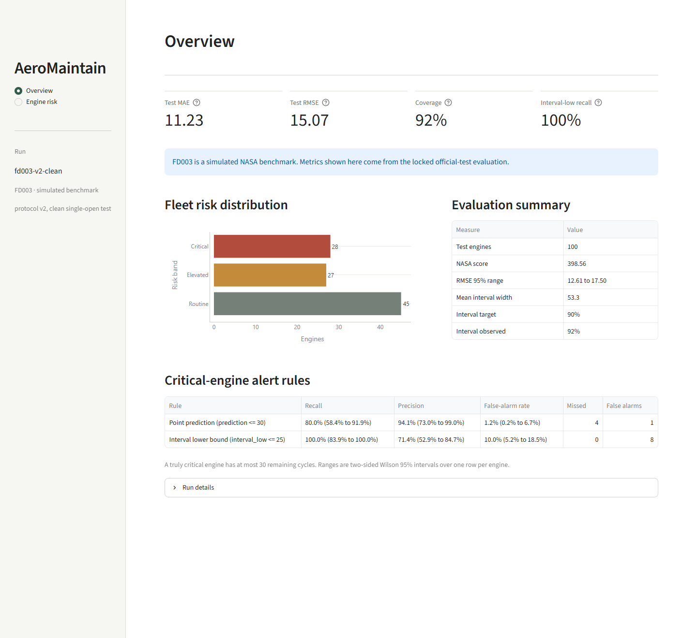
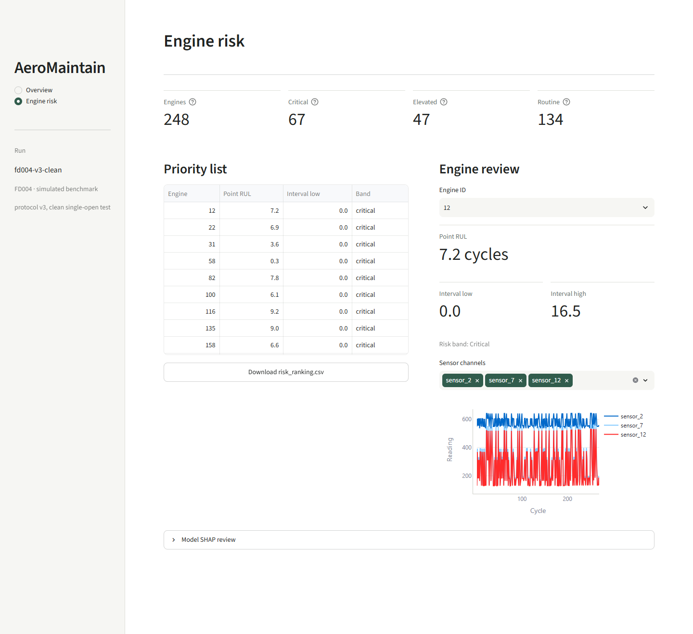

# AeroMaintain AI

[](https://github.com/EfeErim/aeromaintain-ai/actions/workflows/ci.yml)
[](https://aeromaintain-ai-demo.streamlit.app/)

AeroMaintain AI is a reproducible remaining-useful-life (RUL) evaluation project
on NASA's simulated C-MAPSS turbofan benchmark. It turns multivariate engine sensor
histories into per-engine RUL estimates, empirical prediction intervals, risk
rankings, and model-behavior explanations.

The main result is three clean checks, each with its protocol frozen and its test
labels opened once. One operating condition held up, and six did not:

| Clean test | Conditions | Fault modes | Engines | RMSE (95% CI) | Interval coverage, nominal 90% |
|---|---:|---:|---:|---:|---:|
| FD003, protocol v2 | 1 | 2 | 100 | **15.07** (12.61–17.50) | 92% (86–97%) |
| FD002, protocol v3 | 6 | 1 | 259 | **27.36** (23.77–30.82) | 83% (78–87%) |
| FD004, protocol v3 | 6 | 2 | 248 | **27.40** (24.53–30.23) | 83% (78–87%) |

> C-MAPSS contains simulated degradation trajectories. AeroMaintain AI is an
> educational portfolio project, not an airworthiness, maintenance-approval, or
> production-fleet system.

## Results

### Six operating conditions: protocol v3

[Protocol v3](docs/protocol_v3.md) added operating-condition normalization and was
frozen before FD002 or FD004 labels opened. Normalization lowered development RMSE by
10.6% on FD002 and 10.1% on FD004, which met its 10% target. The clean tests then came
in far above development: RMSE 27.4 against 18.9 and 19.6, with interval coverage below
its nominal 90%.

| Metric | FD002, clean | FD004, clean |
|---|---:|---:|
| Run | `fd002-v3-clean` | `fd004-v3-clean` |
| RMSE | **27.36** (23.77–30.82) | **27.40** (24.53–30.23) |
| MAE | 18.46 (15.96–21.01) | 19.65 (17.30–21.99) |
| Signed bias | -8.98 (-12.12 to -5.71) | -9.34 (-12.62 to -6.31) |
| NASA score, total | 10,388 (5,193–16,823) | 5,126 (3,627–6,816) |
| NASA score per engine | 40.1 | 20.7 |
| Interval coverage, nominal 90% | 82.6% (78.0–87.3%) | 82.7% (77.8–87.1%) |
| Mean interval width | 55.8 (52.9–58.7) | 58.5 (55.6–61.3) |

**Why the gap: a diagnosis made after opening.** Predictions top out near 127 cycles
because training targets are capped at 125, while true RUL reaches 194–195 on these
tests. The 14–17% of engines above 150 cycles produce 67–69% of the squared error. The
development window of 150 excluded such rows, so development scoring could not warn of
this. FD001 and FD003 never exposed it, since their true RUL stops at 145.

| Engines by true RUL | FD002 RMSE, coverage | FD004 RMSE, coverage |
|---|---:|---:|
| At most 150 | 16.39, 92% (223 engines) | 17.38, 93% (206 engines) |
| Above 150 | 61.00, 25% (36 engines) | 54.31, 31% (42 engines) |

These subgroup figures are explanatory and do not replace the headline results. Both
tests have now been opened, so a fix would need a new protocol and could not call
either one clean again.

Alert results hold up better, because critical engines sit far from the cap:

| Rule | Dataset | Recall | Precision | Missed | False alarms |
|---|---|---:|---:|---:|---:|
| `prediction <= 30` | FD002 | 57/61, 93% (84–97%) | 93% (84–97%) | 4 | 4 |
| `interval_low <= 25` | FD002 | 60/61, 98% (91–100%) | 73% (63–82%) | 1 | 22 |
| `prediction <= 30` | FD004 | 45/53, 85% (73–92%) | 90% (79–96%) | 8 | 5 |
| `interval_low <= 20` | FD004 | 51/53, 96% (87–99%) | 76% (65–85%) | 2 | 16 |

### One operating condition: protocol v2

Both runs use the same frozen [protocol v2](docs/protocol_v2.md). Ranges are 95%
engine-level bootstrap intervals. Secondary v3 results on these subsets, labeled
`test previously seen`, are in [the results page](docs/results.md).

| Metric | FD003, clean single-open test | FD001, test previously seen |
|---|---:|---:|
| Run | `fd003-v2-clean` | `fd001-v2` |
| RMSE | **15.07** (12.61–17.50) | 15.80 (12.87–18.78) |
| MAE | 11.23 (9.34–13.28) | 11.15 (9.10–13.43) |
| Motor-normalized NASA score | 399 (240–620) | 398 (233–625) |
| Interval coverage, nominal 90% | 92% (86–97%) | 94% (89–98%) |
| Mean interval width | 53.3 (49.3–57.3) | 55.4 (51.2–59.4) |

**Read the FD001 column with care.** Its test labels were seen before v2 was
designed, so it is not independent evidence. Seed 42 is also the best of ten seeds
on FD001: across seeds, RMSE averages 16.03 (SD 0.14, range 15.80–16.21).

#### Critical-engine alerts

A truly critical engine has at most 30 remaining cycles. Each threshold was chosen
on training engines to reach 95% recall with the fewest alarms. Ranges here are
Wilson 95% intervals.

| Rule | Dataset | Recall | Precision | Missed | False alarms |
|---|---|---:|---:|---:|---:|
| `prediction <= 30` | FD003 | 16/20, 80% (58–92%) | 94% (73–99%) | 4 | 1 |
| `interval_low <= 25` | FD003 | 20/20, 100% (84–100%) | 71% (53–85%) | 0 | 8 |
| `prediction <= 30` | FD001 | 20/25, 80% (61–91%) | 100% (84–100%) | 5 | 0 |
| `interval_low <= 20` | FD001 | 24/25, 96% (80–99%) | 86% (69–94%) | 1 | 4 |

The interface uses the interval rule: it misses fewer critical engines and raises
more false alarms. The interval is not a safety guarantee.

### Targets

| Target | Result | Status |
|---|---|---|
| FD001 and FD003 development RMSE at most about 16.6 | v2: 18.57, 17.62. v3: 18.57, 17.86 | **Missed** |
| FD001 and FD003 mean interval width below 45 | v2 training: 55.7, 52.0. v3 training: 55.7, 53.2 | **Missed** |
| FD002 and FD004 development RMSE at least 10% below raw features | 10.6%, 10.1% | Met |
| Risk rule at 95% development recall | FD001 96%, FD002 98%, FD003 100%, FD004 97% | Met |
| One clean holdout check per subset | FD002, FD003, and FD004 each opened once | Met |

No target was set for FD002 or FD004 test RMSE, so 27.4 misses no written figure, but
the coverage shortfall is real: both bootstrap ranges stop below 90%. On FD001 and
FD003, test RMSE falls below 16.6, but that target was defined on development data and
stays missed.

The other v3 candidates did not change the picture. Training emphasis passed nowhere,
and the five-seed ensemble passed only on FD003. Quantile regression with its own tuned
tree counts still produced intervals 54–80% wider than Mondrian on FD001 and FD003. In
v2, LSTM reached 18.39 on FD001 with a worse NASA score.

## Application

The Streamlit application opens one explicitly selected, hash-verified run.

- **Overview** presents test metrics, both alert rules side by side, interval
  coverage, fleet risk distribution, and run identity.
- **Engine risk** presents the ranked engine list, RUL interval, sensor history, and
  model explanation.

The [hosted demo](https://aeromaintain-ai-demo.streamlit.app/) reads a
[row-free bundle](demo/): NASA's dataset page specifies no
license, so the bundle holds aggregate metrics and model outputs only, without
source rows or true RUL.

### Overview

[](docs/screenshots/overview.png)

### Engine risk

[](docs/screenshots/engine-health.png)

## Evaluation workflow

```text
Verify the NASA archive
    → validate and prepare engine trajectories
    → compare Ridge and XGBoost on test-like truncated rows
    → cross-fit the interval and risk threshold on training engines
    → lock the model
    → open official test labels only after the lock
    → review aggregate metrics and engine-level predictions
```

### Leakage controls

- Splits and cross-validation operate on complete engines, never individual cycle
  rows.
- Rolling features use only the current and previous cycles.
- Preprocessing is fitted inside each active training partition.
- XGBoost early stopping uses an inner engine split, never the scored fold.
- Official test RUL labels are stored separately, and the evaluator loads them only
  after `model_lock.json` and its hashes validate.
- A ledger refuses to open a clean holdout for a second model lock.
- Existing run directories are never overwritten, and persisted artefacts are
  connected by SHA-256 hashes.

### Model selection

Development scoring matches the test: one random row per engine, scored against
true RUL, repeated over 200 seeded draws. XGBoost can replace Ridge only by lowering
median RMSE at least 5% without a worse median NASA score. It did so on all four
datasets and won at least 99% of paired draws on each.

These draws use rows with true RUL of at most 150. That window was chosen after
FD001 test labels had been seen, so each run reports the alternatives: XGBoost also
wins at 130 and 175, while Ridge wins with no window because of its better NASA
score. Scores with no window are far worse for both models, because random cuts then
reach rows with more remaining life than any test engine has.

## Run locally

Python `>=3.11,<3.12` is required. From PowerShell:

```powershell
git clone https://github.com/EfeErim/aeromaintain-ai.git
cd aeromaintain-ai
py -3.11 -m venv .venv
.\.venv\Scripts\Activate.ps1
python -m pip install -c constraints/python311-tested.txt -e .
aeromaintain doctor
aeromaintain pipeline --run-id fd001-demo
aeromaintain app --run-id fd001-demo
```

If the NASA archive is not already present, the pipeline downloads it and verifies
its byte size and SHA-256 before extraction. A verified local archive can be supplied
with `--archive PATH`. `--dataset` selects FD001 through FD004. Opening the labels of
FD002, FD003, or FD004 with a new lock is refused once your local ledger has recorded a
run for that subset.

Run the repository quality gate with:

```powershell
python -m pip install -c constraints/python311-tested.txt -e ".[dev]"
ruff check .
ruff format --check .
pytest --cov=src/aeromaintain --cov-fail-under=80
```

## Documentation

- [Reference run results](docs/results.md)
- [Protocol v3](docs/protocol_v3.md) and its
  [development evidence](docs/protocol_v3_development.json)
- [Protocol v2](docs/protocol_v2.md)
- [Machine-readable reference evidence](docs/reference_evidence.json)
- [RUL model card](docs/model_card.md)
- [C-MAPSS data card](docs/data_card.md)
- [Architecture and trust boundaries](docs/architecture.md)
- [Research basis](docs/research.md)
- [Changelog](CHANGELOG.md)

## Limitations

- The data is simulated; it is not operational fleet telemetry.
- The RUL cap limits predictions to about 127 cycles, so engines with more life left
  are underpredicted, and on FD002 and FD004 their intervals usually miss.
- Interval coverage on FD002 and FD004 fell short of its nominal 90%.
- Critical-engine figures rest on 20–61 engines, so their intervals are wide.
- FD001 and FD003 development RMSE and interval-width targets were missed.
- The eligibility window of 150 was an analysis choice. It hid the cap's cost during
  development on FD002 and FD004, and removing it changes the Ridge-versus-XGBoost
  outcome on all four subsets.
- FD002 and FD004 used a shorter search than FD001 and FD003, under
  [Amendment 1](docs/protocol_v3.md#amendment-1), so a better setting may have been
  missed.
- The nominal empirical interval is not a safety guarantee, and results do not
  establish performance under real distribution shift.

## License

Project code and documentation are licensed under the MIT License. This does not
grant rights to redistribute NASA source data.
