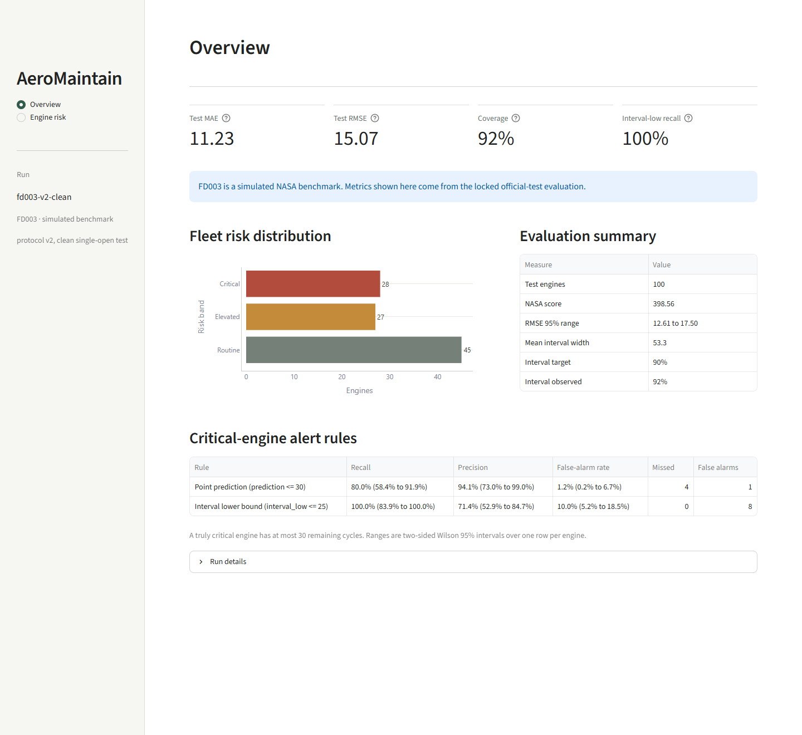

# AeroMaintain AI

[](https://github.com/EfeErim/aeromaintain-ai/actions/workflows/ci.yml)
[](pyproject.toml)
[](LICENSE)
[](https://aeromaintain-ai-demo.streamlit.app/)

Remaining-useful-life (RUL) prediction for turbofan engines on NASA's simulated C-MAPSS
and N-CMAPSS benchmarks: archive verification, leakage-safe features, Ridge/XGBoost,
empirical prediction intervals, maintenance alarms and a Streamlit review app. On 35
unseen N-CMAPSS engines it cuts RMSE from 22.7 (baseline) to 13.1 with 92.5% interval
coverage.

Each test set was opened once, after the model and its thresholds were locked and
committed. The tooling refuses a second opening; the single opening itself is my own
attestation, and [architecture](docs/architecture.md#what-opened-once-does-and-does-not-prove)
lists what the code does and does not enforce.



## Results

| Test set | Engines | RMSE (95% CI) | 90% interval coverage | Evidence |
|---|---:|---:|---:|---|
| C-MAPSS FD003 | 100 | 15.07 (12.61–17.50) | 92% | [v2](docs/results.md#protocol-v2-runs) |
| C-MAPSS FD002 | 259 | 27.36 (23.77–30.82) | 83% | [v3](docs/results.md#protocol-v3-runs) |
| C-MAPSS FD004 | 248 | 27.40 (24.53–30.23) | 83% | [v3](docs/results.md#protocol-v3-runs) |
| N-CMAPSS DS01, DS08a, DS08c | 35 | 13.06 (11.13–15.00), baseline 22.70 | 92.5% | [v5](docs/results_v5.md) |

The [hosted demo](https://aeromaintain-ai-demo.streamlit.app/) shows the clean FD004
test (`fd004-v3-clean`, 248 engines, RMSE 27.40), the weakest C-MAPSS row; the
long-life engines explained below account for most of its error.

A single-open test cannot be rerun, so the linked pages hold the stored evidence and
hashes. The N-CMAPSS range was corrected on 2026-11-09: the original bootstrap resampled
only two engines; point values and gate results did not change
([erratum](docs/results_v5.md#erratum-bootstrap-ranges-2026-11-09)).

- The v5 alarm fired for 32 of 35 engines while 10–30 cycles remained. The predeclared
  limit was 3 misses, so it passed with no margin; requiring the alarm to start inside
  the window would have failed it ([sensitivity checks](docs/results_v5.md#sensitivity-checks-2026-11-16)).
  The other two v5 gates were lenient, so "all gates passed" mostly rests on the alarm.
- Scored the way most papers do (true RUL capped at 125), FD002 and FD004 come out at
  14.74 and 15.33. That rescoring came after the labels were open
  ([comparison](docs/results.md#retrospective-comparison-on-the-literature-scale)).
- FD002/FD004 error comes mostly from long-life engines: the training target is capped
  at 125. Removing the cap fixed that but missed more critical engines, so the capped
  model stayed ([v4](docs/results_v4.md)).

[Protocol history](docs/protocol_history.md) lists every experiment, including the
failures.

## Run it

Python 3.11.

```bash
git clone https://github.com/EfeErim/aeromaintain-ai.git
cd aeromaintain-ai
python -m venv .venv && source .venv/bin/activate   # Windows: .venv\Scripts\activate
pip install -c constraints/python311-tested.txt -e ".[dev,ncmapss]"

aeromaintain pipeline --run-id fd001-demo   # downloads and verifies the NASA archive
aeromaintain app --run-id fd001-demo
```

`--dataset` selects FD001–FD004 and `--archive PATH` uses a local copy. The FD001
pipeline takes about 11 minutes on CPU ([captured output](docs/demo.md)). Without the
NASA download, the same pipeline runs on generated FD001-shaped data in a directory
outside the repository; its numbers describe no real engine:

```bash
aeromaintain pipeline --synthetic --run-id demo --project-root ../aeromaintain-synthetic
aeromaintain app --run-id demo --project-root ../aeromaintain-synthetic
```

`aeromaintain --help` lists the single stages (`prepare`, `train`, `evaluate`, `finish`,
`export-demo`) and the studies behind the robustness figures (`robustness`,
`escalation-study`, `compare-runs`; see [results](docs/results.md)). The N-CMAPSS
protocols run as `python -m aeromaintain.models.v4` and `python -m
aeromaintain.models.v5` ([v4 commands](docs/results_v4.md#reproduction-and-provenance),
[v5 protocol](docs/protocol_v5.md)).

Checks, as CI runs them: `ruff check .`, `ruff format --check .` and
`pytest --cov=src/aeromaintain`, then the synthetic pipeline above
and a render of the hosted demo from `requirements.txt` alone
(`python scripts/check_demo.py`).

## How it works

```text
NASA archive (size + SHA-256 checked)
  → engine-level train/validation splits, causal rolling features
  → Ridge vs. XGBoost, selected on truncated rows that look like the test set
  → empirical intervals and alarm threshold, cross-fitted per engine
  → model lock: model, intervals and thresholds hashed and committed
  → test labels loaded only if the lock verifies; a ledger refuses a second lock
```

Splits and CV folds are by engine, rolling features only look backwards, XGBoost early
stopping uses an inner engine split, and test labels live in a separate file read only
after the lock validates.

## Design decisions

- **Open each test set once.** Tuning against the test set biases every number by an
  unknown amount. The cost is that bad results stay published (v4 was negative; v5 passed
  its alarm gate with no margin).
- **Score development on one random cut per engine.** The test has one prediction per
  engine, so development takes the median over 200 random cuts per engine. The 150-cycle
  window for those cuts is a disclosed choice.
- **Alarm on three consecutive cycles.** Single predictions near failure are noisy. On
  the v5 test the persistent point alarm confirmed a median 22 cycles before failure with
  0.26 false events per engine; alarming on the interval lower bound gave 55 cycles of
  lead but 2.57 false events per engine.
- **Intervals banded by predicted RUL (Mondrian).** Errors grow with predicted life, so
  one global margin is too wide near failure. Conformalized quantile regression gave
  intervals 77% wider.
- **Ridge and XGBoost, not a deep model.** An LSTM challenger was 0.95% better on median
  RMSE with a worse NASA score, short of the 5% bar
  ([challengers](docs/results.md#challengers-on-fd001)).

More in [architecture](docs/architecture.md), the
[model and data card](docs/model_card.md) and the [research notes](docs/research.md).

## Limitations

- Both benchmarks are simulated; nothing here says anything about real engines.
- The final test has 35 engines; per-subset results rest on 10–15 engines.
- Coverage on FD002 and FD004 fell short of the nominal 90%.
- No state-of-the-art claim. Published deep models report similar or lower capped RMSE,
  usually after repeated use of the test set.

## Data and license

Code and documentation are MIT licensed. NASA's dataset page specifies no license, so
the repository and the hosted demo hold no source rows or true RUL values, only aggregate
metrics and model outputs.
