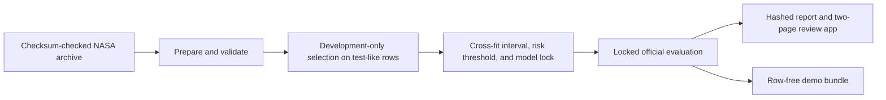

# Architecture

## Evaluation flow

Reusable logic lives under `src/aeromaintain/`:

- `data/pipeline.py` verifies and prepares FD001 and FD003;
- `features/causal.py` creates past-and-current-only rolling features;
- `evaluation/protocol.py` measures truncated rows, intervals, risk thresholds,
  and bootstrap uncertainty;
- `models/rul.py` selects, calibrates, persists, and locks the model;
- `models/evaluation.py` validates the lock before opening official labels;
- `models/robustness.py` repeats a locked specification across seeds and compares
  runs byte by byte;
- `models/escalation.py` scores the LSTM and CQR challengers on training engines;
- `delivery.py` runs preparation through the report and marks completion only
  after all stages pass;
- `app/artifacts.py` verifies the hash chain and exposes a prediction schema
  without true RUL; and
- `app/main.py` renders Overview and Engine risk, from a verified run or a row-free
  bundle.

## Trust boundaries

Selection uses development engines only. Calibration and the final fit use all
training engines after selection, with locked settings. Official test labels are
opened only after `model_lock.json` and every referenced file pass hash validation.
For a clean holdout, `runs/holdout_ledger.json` also refuses any second model lock.
The public review table deliberately excludes `rul_true`, and the demo bundle holds no
NASA rows.

## Run state

Model training creates a new run and refuses an existing ID. Evaluation adds a
separately verified artefact group. The end-to-end workflow writes
`report.json` and `report.html`, then atomically changes the run manifest from
`model_locked` to `pipeline_complete`. A failure before that replacement remains
visibly incomplete.

The application requires an explicit run ID and checks:

1. run and model-lock identity;
2. locked data, config, model, explanation, and feature hashes;
3. official-evaluation hashes; and
4. report hashes for pipeline-complete runs.

`runtime.py` also records the Python, platform, installed distributions, and
tested-constraints hash for new runs.
