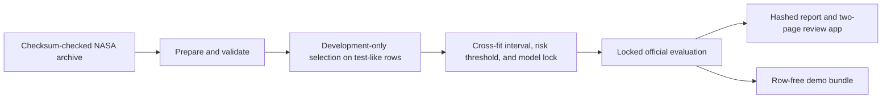

# Architecture

## Evaluation flow



## Frozen and maintained code

Some modules ran published experiments and are pinned by SHA-256 in
`docs/ncmapss_locks/final_v5.json` (and, for older versions, in
`docs/protocol_v4_evidence.json`). They are never edited, and
`tests/test_protocol_v5.py` fails if one changes. The reasoning is in
[decision 0001](decisions/0001-frozen-experiment-code.md).

| Frozen (lock-pinned) | Role |
|---|---|
| `models/rul.py` | C-MAPSS selection, training, calibration and model locks (v2, v3) |
| `models/v4.py`, `models/v5.py` | N-CMAPSS protocol runs |
| `evaluation/protocol.py`, `evaluation/v4.py` | Truncated scoring, intervals, alarm replay |
| `evaluation/ledger.py` | Single-open holdout ledger |
| `data/ncmapss.py` | N-CMAPSS HDF5 reader |

Maintained modules can change freely, as long as runs that already exist keep
loading:

- `data/pipeline.py` verifies and prepares FD001 through FD004;
- `features/causal.py` builds past-and-current-only rolling features, optionally on
  sensors normalized within each operating condition;
- `artifacts.py` holds the JSON contracts for run manifests, model locks, evaluation
  manifests and the public bundle, and loads runs after checking them; it has no UI
  dependency;
- `models/evaluation.py` validates a C-MAPSS lock, opens the official labels once and
  writes the evaluation;
- `models/inference.py` loads a locked model and predicts with it;
- `models/run_files.py` writes the write-once files inside a run;
- `models/robustness.py` and `models/escalation.py` refit locked specifications with
  the frozen training code, for seed sweeps and the LSTM and CQR challengers;
- `delivery.py` runs preparation through the report and records completion;
- `app/main.py` renders the Streamlit pages; `app/artifacts.py` only re-exports the
  loaders from `artifacts.py` for older imports.

Dependencies point one way: `app` and `cli` use `delivery` and `artifacts`;
`delivery` uses `artifacts` and the `models` package API; nothing outside `app`
imports `app`.

## Trust boundaries

Selection uses development engines only. Calibration and the final fit use all
training engines after selection, with locked settings. Official test labels are
opened only after `model_lock.json` and every referenced file pass hash validation.
For a clean holdout, `runs/holdout_ledger.json` also refuses any second model lock.
The public review table deliberately excludes `rul_true`, and the demo bundle holds no
NASA rows.

## What artefact verification guarantees

`artifacts.load_verified_run` and `load_public_bundle` check, before returning:

1. each JSON file against its schema: hashes are 64 lowercase hex characters,
   artefact maps are objects, statuses and lock schema versions (2 and 3) are known,
   and a `pipeline_complete` manifest has a pipeline record;
2. that each artefact map is non-empty and lists every file the run needs: the model
   lock lists `explanation.json` and every model, preprocessor, normalizer and
   quantile file its champion and calibration name; the pipeline record lists both
   reports and the evaluation manifest; the public bundle lists exactly `run.json`
   and `risk_ranking.csv`;
3. that every listed path stays inside its run or bundle directory and still has
   its listed SHA-256;
4. that the public ranking has exactly the review columns with numeric values and
   known risk bands, and that no key named `rul_true` or `sensor_history` appears
   anywhere in `run.json`.

Run files written by earlier versions carry extra fields, so run-level schemas accept
unknown fields. The public bundle has a single writer, so its files reject them.

Verification shows that files are unchanged since they were listed. It does not
make a `.joblib` file safe to load: a run directory from someone else can list a
malicious pickle with a correct hash. Load only runs this project produced.

## Run states and resuming

| State | Meaning |
|---|---|
| `model_locked` | Lock written; official labels not opened |
| `model_locked` + `official_test/evaluation_manifest.json` | Evaluation recorded |
| `pipeline_complete` | Reports written and listed; the manifest is the commit point |

`aeromaintain finish --run-id ID` moves a run forward from wherever it stopped:

- it evaluates only when `official_test/` is empty, so a recorded evaluation is
  reused and labels are not read twice;
- if result files exist without an evaluation manifest, it stops: the labels may
  already have been read, and that needs a person to look;
- reports are deterministic; one left by an interrupted call is accepted if its
  bytes match, and a different one is refused, never overwritten;
- the manifest is replaced last and atomically, so a run never reads as complete
  before its reports exist;
- on a complete run it verifies everything and changes nothing;
- an OS file lock under `runs/` refuses a second concurrent `finish` or
  `pipeline` for the same run; the OS releases it if the process dies.

Each file is replaced atomically, but the set of files is not a transaction and none
of this protects against power loss during a write. The next `finish` verifies what
it finds instead of trusting it.

## Compatibility

- `.joblib` files store `aeromaintain.models.rul.RidgeBundle`,
  `aeromaintain.features.causal.FoldPreprocessor` and `ConditionNormalizer` by
  module path; those classes do not move.
- `aeromaintain.app` and `aeromaintain.app.artifacts` still export the loaders and
  `AppArtifacts` (now an alias of `RunArtifacts`).
- `models.evaluation._validate_lock` remains as an alias of `validate_lock`.
- Reports regenerated from the stored C-MAPSS runs are byte-identical to the stored
  `report.json` and `report.html`, so `finish` accepts them.

## Checking a run or a change

```bash
aeromaintain finish --run-id fd001-demo        # resumes, or verifies a finished run
pytest tests/test_protocol_v5.py -k lock       # frozen files still match the v5 lock
pytest --cov=src/aeromaintain --cov-fail-under=80
```

On Windows, if pytest cannot use the system temporary directory, pass a fresh
`--basetemp` inside the repository (for example `.local/pytest`).

`runtime.py` records the Python, platform, installed distributions, and
tested-constraints hash for new runs.
